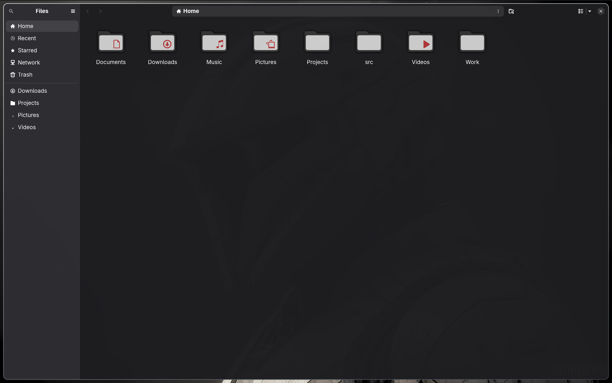
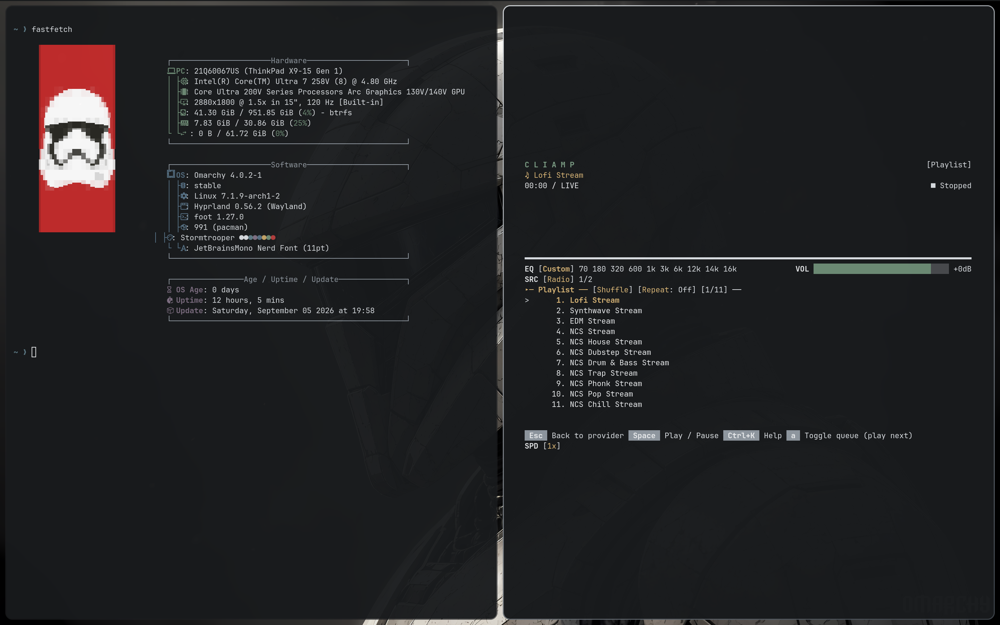

# Omarchy Stormtrooper Theme

[](https://omarchy.org/)
[](https://wayland.freedesktop.org/)
[](LICENSE)

> [!IMPORTANT]
> **Project Status — Shared "As-Is" / Not Actively Maintained**
>
> This Stormtrooper theme was built primarily for my personal **Omarchy Linux** setup and is **not an actively maintained project**. It is shared publicly **"as-is"** in the hope that it may be useful to others — you are welcome to use, modify, or fork it freely under the [MIT License](LICENSE), though issues and pull requests may not receive responses.

An elite, highly polished dark-mode theme inspired by the classic Star Wars Imperial aesthetic.

<p align="center">
  
</p>

## Overview

The **Stormtrooper Theme** brings a refined, weathered armor aesthetic to the Omarchy desktop environment. Designed specifically for deep-contrast dark mode environments, it eliminates harsh bright highlights in favor of dusty, weathered armor grey-whites and deep blaster carbon-greys, framed by sleek, angled active border gradients.

## Features

- **System-Wide Palette (colors.toml)**: Clean, unified colors utilizing a deep carbon/charcoal base (#181A1C, #212427) and muted greyish-white foregrounds (#D8DCE0) for comfortable, high-legibility, and glare-free readouts.
- **Custom Wallpaper Rotation**: Seven hand-composited, high-resolution (2880x1800) wallpapers, each featuring a subtle, resized, and transparent gray Omarchy wordmark in the bottom-right corner.
- **Gradient Borders (Lua-Safe)**: Natively integrated, angled (45 degrees) linear gradients for active window borders in Hyprland and matching container outline frames in GTK (gtk.css).
- **NouveauKDEgray Icon Integration**: Full file manager, place, device, and panel icon styling utilizing a muted gray icon theme.

## Installation

### Quick Install

Simply clone this repository directly into your Omarchy theme directory and set it active:

```bash
git clone https://github.com/techaeris/omarchy-stormtrooper-theme.git ~/.config/omarchy/themes/stormtrooper
omarchy theme set stormtrooper
```

### Manual Configuration

1. **Verify Icon Theme**:
   Ensure you have the custom eQuest - Red (or nouveKDEgray) icon themes placed under ~/.local/share/icons/ and update your system settings (gsettings set org.gnome.desktop.interface icon-theme "eQuest - Red").
2. **Reload Compositor and Shell**:
   Refresh Hyprland borders and the status bar:
   ```bash
   hyprctl reload
   omarchy restart shell
   ```

## Compatibility and Requirements

- **Base OS**: Arch Linux with [Omarchy](https://omarchy.org/) desktop environment.
- **Window Manager**: Hyprland (with Lua configuration parser).
- **Dependencies**: imagemagick (for dynamic asset adjustments and wordmark composite generation).


## Gallery

| Tiled Workspace | Application Overview |
| :---: | :---: |
|  |  |

## Credits and License

- **Aesthetic**: Inspired by Star Wars Imperial aesthetics (Lucasfilm Ltd. IP / Fair Use Notice).
- **License**: Published under the MIT License.
